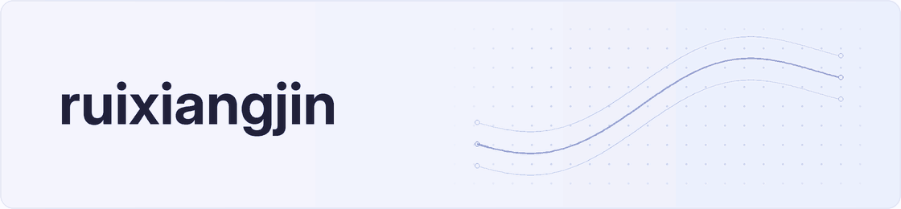

  <picture>
    <source media="(prefers-color-scheme: dark) and (prefers-reduced-motion: reduce)" srcset="./assets/profile-dark.png">
    <source media="(prefers-reduced-motion: reduce)" srcset="./assets/profile-light.png">
    <source media="(prefers-color-scheme: dark)" srcset="./assets/profile-dark.gif">
    
  </picture>

## 项目

  
  <strong><a href="https://github.com/ruixiangjin/monash-study-agent">Monash Study Agent</a></strong> 
  正在开发的学习 Agent，尝试把资料整理、检索和记忆放到一起。

  
  <strong><a href="https://github.com/ruixiangjin/monash-moodle-downloader">Monash Moodle Downloader</a></strong> 
  同步有权访问的 Moodle 课程资料，支持按课程或周更新。

  
  <strong><a href="https://github.com/ruixiangjin/monash-ed-downloader">Monash ED Downloader</a></strong> 
  保存有权访问的 Ed Discussions、Lessons 和非媒体附件。

